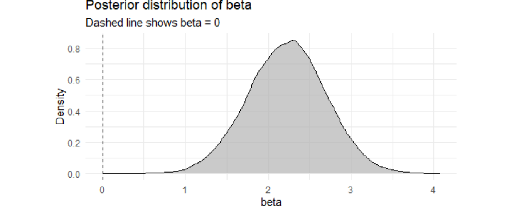
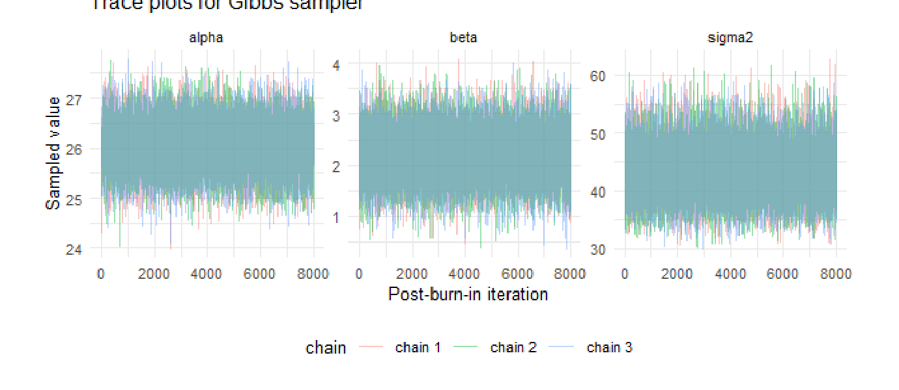
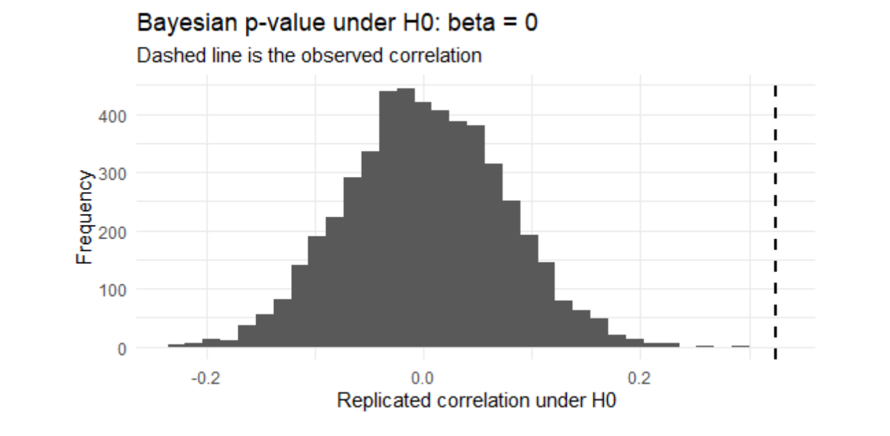

# ⚽ FIFA Rankings & National Team Performance
### A Bayesian Linear Regression Analysis in R

   

**Do national teams with higher FIFA ranking points also record more wins?**

This project examines the relationship between pre-tournament FIFA ranking points and national teams' wins over the previous four years. Using 192 team–tournament observations from six Men's World Cups (2002–2022), I implemented Bayesian linear regression with a **Gibbs sampler written from scratch in R**.

This is a **descriptive association, not a causal analysis**: both FIFA points and recent wins are influenced by match results.

## At a glance

| Metric | Result |
|:--|--:|
| National team–tournament observations | **192** |
| Posterior mean of standardized FIFA-points slope (β) | **2.23** |
| 95% credible interval for β | **[1.30, 3.14]** |
| Posterior probability, P(β > 0 \| data) | **> 0.999** |
| OLS R² | **0.106** |

**Interpretation:** Teams with FIFA points one standard deviation higher are expected to have about **2.23 additional wins** over the preceding four years, on average, under the fitted model. FIFA points explain only around **10.6%** of the variation in wins, so they do not fully capture recent winning performance.

## Results and visualizations

### Posterior inference



*The posterior for β is concentrated above zero. The dashed reference marks β = 0.*

### Gibbs-sampler convergence



*Three chains (10,000 iterations each, with 2,000 burn-in iterations removed). The original analysis additionally assesses R-hat and effective sample size.*

### Posterior predictive check under the null



*Under a zero-slope null model, replicated correlations rarely reach the observed correlation (0.325). The reported posterior predictive tail probability is approximately 0.0002.*

*Figures are reproduced from the original submitted report.*

## Statistical approach

- **Model:** `wins_last_4y` as the outcome; standardized `fifa_points_pre_tournament` as the predictor, with a Normal likelihood.
- **Priors:** α ~ Normal(25, 10²), β ~ Normal(0, 5²), and σ² ~ Inverse-Gamma(2, 49).
- **Computation:** Custom Gibbs sampler alternating conditional draws for regression coefficients and residual variance; three independent chains.
- **Diagnostics:** Trace plots, potential scale reduction (R-hat), and effective sample size.
- **Robustness:** Posterior predictive model checking and prior sensitivity analysis (`J`, `2J`, `3J`).
- **Benchmark:** Ordinary least squares estimates and a residual-based comparison of team performances.

## Reproduce the analysis

**Requirements:** R, [Quarto](https://quarto.org/), and the R packages `MASS`, `tidyverse`, `coda`, `broom`, and `knitr`.

1. Clone or download this repository.
2. Open R and install any missing dependencies:

   ```r
   install.packages(c("MASS", "tidyverse", "coda", "broom", "knitr"))
   ```

3. From the repository's root directory, render the source:

   ```bash
   quarto render analysis.qmd
   ```

The source currently specifies **Word (`docx`) output**. The original completed PDF is provided separately as [`report.pdf`](report.pdf). The reproducibility command has not been re-executed in this repository's preparation environment, so results are reported from the original analysis.

## Repository contents

| Path | Purpose |
|:--|:--|
| [`analysis.qmd`](analysis.qmd) | Complete Quarto analysis and R implementation |
| [`train.csv`](train.csv) | Dataset used by the analysis |
| [`report.pdf`](report.pdf) | Original academic report, with student ID removed |
| [`figures/`](figures/) | Three selected figures extracted from the report |

## Dataset and attribution

**Source:** Harrachi Mustapha (2026), *[FIFA World Cup Team Dataset](https://www.kaggle.com/datasets/harrachimustapha/fifa-world-cup-team-dataset)*, Kaggle. The original report identifies the dataset as released under **[CC BY 4.0](https://creativecommons.org/licenses/by/4.0/)**. Attribution is retained here.

## Limitations

The outcome is a count of wins, but a Normal linear regression is used as a simplifying assumption. A Poisson or negative binomial model would be a natural extension. The model also includes only FIFA points; it omits potentially relevant factors such as the number of matches played. Finally, the association is not causal because ranking points are themselves affected by prior match outcomes.

## Author

**Badr El Jaouhari** — Academic project in Bayesian Statistics.

For derivations, tables, source references, and the original AI-use disclosure, see the [full report](report.pdf) and [Quarto source](analysis.qmd).
